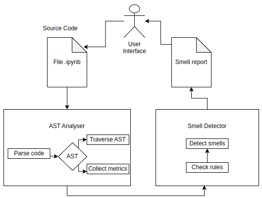

<div align="center">

# 🔍 NotebookAnomalyDetection

**Automatic detection of code smells in Jupyter notebooks used for Machine Learning**

[](#)
[](#)
[](#)
[](#)
[](#)
[](LICENSE)

</div>

---

## 📌 Overview

Jupyter notebooks are the default environment for data science and ML prototyping, but they tend to accumulate hard-to-maintain code: oversized cells, deeply chained indexing, unreadable comprehensions, and so on.

**NotebookAnomalyDetection** analyzes `.ipynb` files **cell by cell**, extracts static code metrics from the Python AST, and flags **5 code smells** using two complementary approaches:

| | Approach | How it works |
|---|---|---|
| **Technique 1** | Rule-based (metrics + thresholds) | AST metrics are compared to empirically calibrated thresholds |
| **Technique 2** | Learning-based (XGBoost) | A multi-label classifier trained on the same metrics |

The project also includes the full **research pipeline**: notebook collection from GitHub, random sampling, manual labeling, metric distribution analysis, and evaluation.

> Developed as part of a research internship (Mitacs Globalink) at ÉTS, Montréal.

---

## 🧪 Detected code smells

| Code | Smell | Detection rule (Technique 1) |
|---|---|---|
| **LC** | Long Cell | `SLOC ≥ 13` **and** (`CC + FC ≥ 10` **or** `VOL ≥ 30`) |
| **LEC** | Long Element Chain | `DNA ≥ 2` **or** `LOEC ≥ 7` |
| **CCC** | Complex Container Comprehension | `NOL + NOCC ≥ 1` **and** `LOC ≥ 50` |
| **LE** | Long Expression | `NOCE ≥ 87` |
| **CIC** | Complex IF Condition | `DNIC ≥ 2` **or** `NOIC ≥ 3` |

Thresholds are configurable in [`technique1/thresholds.json`](technique1/thresholds.json).

<details>
<summary><b>📖 Metric glossary</b></summary>

| Metric | Meaning |
|---|---|
| SLOC | Source lines of code in the cell |
| CC | Cyclomatic complexity |
| FC | Functional complexity |
| VOL | Halstead volume |
| DNA | Depth of nested array access |
| LOEC | Length of element chain |
| NOL + NOCC | Number of loops + conditions inside a comprehension |
| LOC | Length of the comprehension (characters) |
| NOCE | Number of characters in an expression |
| DNIC | Depth of nested IF conditions |
| NOIC | Number of IF conditions |

</details>

---

## 🏗️ Architecture



1. **UI (React)** — the user uploads one or more `.ipynb` files.
2. **AST Analyzer (Python)** — each code cell is parsed into an AST and the metrics above are computed (magic commands and cells with syntax errors are skipped).
3. **Smell Detector** — rules (Technique 1) or the XGBoost model (Technique 2) are applied to the metrics.
4. **Report** — a CSV file (`File, Cell, LC, LEC, CCC, LE, CIC`) is returned for download.

---

## 📊 Results

### Technique 1 — rule-based, vs. manual labeling

Evaluated on **383 code cells** randomly sampled from the corpus (95 % confidence level, 5 % margin of error) and labeled manually.

| Smell | Positives | Precision | Recall | F1 |
|---|:-:|:-:|:-:|:-:|
| LC | 67 | 0.953 | 0.910 | 0.931 |
| LEC | 13 | 1.000 | 0.923 | 0.960 |
| CCC | 9 | 1.000 | 1.000 | 1.000 |
| LE | 103 | 1.000 | 0.971 | 0.985 |
| CIC | 15 | 0.933 | 0.933 | 0.933 |
| **Global** | **207** | **0.980** | **0.947** | **0.963** |

Global accuracy: **0.992** · MCC: **0.959**

### Technique 2 — model comparison

| Model | Accuracy | MCC | F1 | Precision | Recall |
|---|:-:|:-:|:-:|:-:|:-:|
| Decision Tree | 0.965 | 0.819 | 0.833 | 0.926 | 0.758 |
| Random Forest | 0.967 | 0.828 | 0.840 | 0.943 | 0.758 |
| **XGBoost** | **0.983** | **0.914** | **0.924** | 0.924 | 0.924 |

XGBoost was retained as the final model ([`technique2/trained_xgboost_model.pkl`](technique2/trained_xgboost_model.pkl)).

---

## 🚀 Quick start

### Prerequisites
- Python 3.9+
- Node.js 18+ (for the web interface)
- Docker (optional)

### Option A — Web app with Docker

```bash
git clone https://github.com/jouhaina-nasri/NotebookAnomalyDetection.git
cd NotebookAnomalyDetection
docker compose up --build
```

This starts the Flask API on port 5000 and the React UI on port 3000.

Open http://localhost:3000, select your notebooks and click **Analyser**: the CSV report downloads automatically.

### Option B — Command line

```bash
git clone https://github.com/jouhaina-nasri/NotebookAnomalyDetection.git
cd NotebookAnomalyDetection/technique1
pip install -r requirements.txt

# Rule-based detection on a folder of notebooks
python detector.py path/to/notebooks -o results.csv
```

Rule-based detection via the API:

```bash
curl -F "notebook_files=@my_notebook.ipynb" http://localhost:5000/analyze -o results.csv
```

XGBoost detection:

```bash
pip install -r technique2/requirements.txt
python technique2/python_parser.py nb1.ipynb nb2.ipynb   # → predictions.csv
```

### Example output

```csv
File,Cell,LC,LEC,CCC,LE,CIC
train_model.ipynb,3,1,0,0,1,0
train_model.ipynb,7,0,0,1,0,0
```

---

## 🔬 Research pipeline

```
collect_data ──► data ──► manual_labeling ──► extract_notebook
 (clone repos)  (3 100+     (random sample      (cell contents
                notebooks)   of 383 cells)        for labeling)
       │
       ▼
   metrics ──► boxplot ──► threshold calibration ──► technique1 / technique2 ──► precision_recall / validate
```

---

## 📁 Repository structure

| Folder | Content |
|---|---|
| [`architecture/`](architecture) | Architecture diagram of the tool |
| [`collect_data/`](collect_data) | Scripts to clone GitHub repositories and gather `.ipynb` files |
| [`data/`](data) | Corpus of collected Jupyter notebooks |
| [`manual_labeling/`](manual_labeling) | Random cell sampling (Python + R) and manual labels |
| [`extract_notebook/`](extract_notebook) | Extraction of cell source code for labeling |
| [`metrics/`](metrics) | Metric values per cell (CSV) |
| [`boxplot/`](boxplot) | Metric distributions per smell, used to set thresholds |
| [`technique1/`](technique1) | Metric calculators, rule-based detector, Flask API, React UI |
| [`technique2/`](technique2) | Training dataset, XGBoost model, model comparison |
| [`precision_recall/`](precision_recall) | Precision / recall / MCC / F1 against manual labels |
| [`validate/`](validate) | Confusion matrices, ROC curves, cross-validation |

---

## ⚠️ Limitations

- Analysis is **static and cell-level**: smells spanning several cells are not detected.
- Manual labeling was done by a single developer; inter-rater agreement was not measured.
- Thresholds were calibrated on the same corpus used for evaluation, so results on unseen notebooks may be lower.

## 🛣️ Roadmap

- [ ] Package as a pip-installable CLI (`nbsmell analyze <path>`)
- [ ] Single `docker-compose up` for API + UI
- [ ] Unit tests and GitHub Actions CI
- [ ] Highlight smelly cells directly in the UI
- [ ] JupyterLab extension

---

## 👩‍💻 Author

**Jouhaina Nasri** — Software Engineer
[GitHub](https://github.com/jouhaina-nasri)

## 📄 License

Distributed under the MIT License. See [`LICENSE`](LICENSE).
